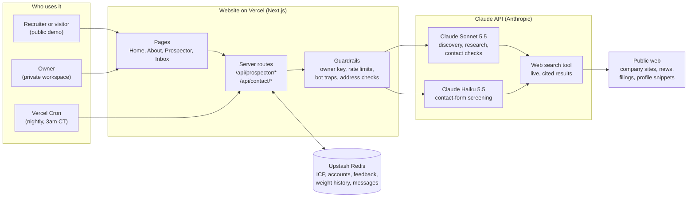
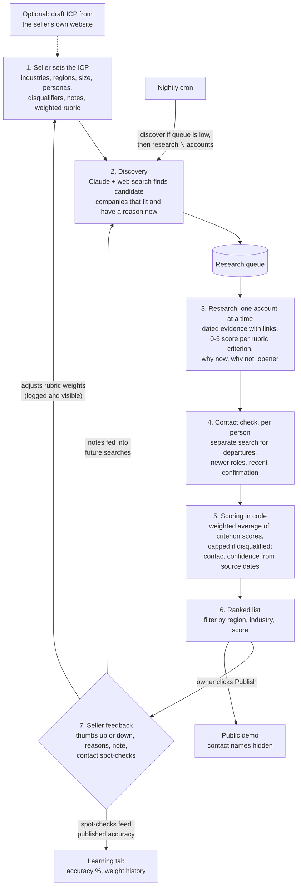
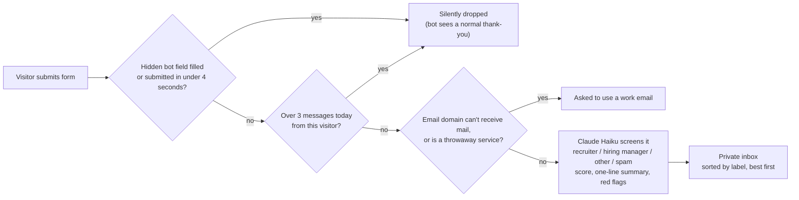

# Sales AI Lab: How It Works

A public portfolio of AI tools for B2B sellers, built on Claude and hosted on Vercel. Live site: https://sales-ai-lab-seven.vercel.app

Every tool has to pass one test: it saves a seller time, sharpens a decision, or both. Each one also has to do something a plain chat with an AI can't, such as pulling live data, running math in code, remembering feedback, or working in the background.

---

## 1. The big picture

**In plain terms:** the website is the storefront. The server routes are the back office, where the API key lives and visitors never see it. Claude does the reading and reasoning. The database is the memory. Vercel's scheduler wakes the system up every night to keep working.

---

## 2. The ICP Prospector pipeline

The Prospector finds accounts that fit right now, explains why with dated sources, names buyers only when a source does, checks those buyers are still in their jobs, and ranks everything with math the seller controls.

### What the AI decides vs. what code decides

| Step | Done by | Why |
| --- | --- | --- |
| Finding candidate companies | Claude + web search | Needs judgment and live data |
| Reading evidence, scoring each criterion 0-5 | Claude + web search | Needs reading comprehension and reasoning |
| Checking a contact still holds the role | Claude + web search (separate pass) | An independent second look catches stale data |
| **Final account score** | **Code** | Weighted math from the seller's rubric. The AI never grades itself |
| **Contact confidence (high/medium/low)** | **Code** | Based on how recent the newest evidence is: 4 months or less = high, a year or less = medium, older or unknown = low. Departed = low |
| **Learning from feedback** | **Code** | Thumbs up shifts weight toward what that account scored high on. Thumbs down shifts it away. Weights always total 100%, and every change is logged |
| Ranking and filtering | Code | Deterministic and repeatable |

### How a single research run works

1. The server sends Claude the seller's ICP, the rubric, past feedback notes, and the target company.
2. Claude runs up to 6 live web searches: earnings calls, press releases, leadership changes, funding, hiring, expansions.
3. Claude must return its answer in a fixed structure (dated evidence, scores, contacts, opener). If it answers in plain text, the server asks again.
4. Each named contact gets its own verification search, including current profile headlines in search results.
5. Code computes the score and confidence, then saves the account.

Each research run gets its own 5-minute window, so long research never times out the page.

---

## 3. The screened contact form

The site never shows an email address. Messages go through a form and get screened before the owner sees them.

---

## 4. Guardrails

| Risk | Protection |
| --- | --- |
| Strangers running up the AI bill | Per-visitor daily limits, site-wide daily caps, and a hard monthly spend limit at Anthropic |
| Someone using the owner's workspace | Owner key checked on the server for every private action |
| Strangers triggering the nightly job | Cron secret required |
| The server being tricked into fetching private network addresses | Every address, and every redirect, is checked before fetching |
| Exposing real people's names publicly | The public demo hides contact names and verification notes |
| AI making things up | Fixed output structure, sources and dates required, "inferred" vs. "from site" labels, independent contact checks, seller spot-checks measured as an accuracy % |
| Prompt injection through the contact form | Message text is treated as data, and the screener is told to ignore instructions inside it |

---

## 5. Data stored

| Store key | What it holds |
| --- | --- |
| `prospector:owner:settings` | ICP, rubric weights, nightly batch size |
| `prospector:owner:accounts` | Every account: evidence, scores, contacts, checks, feedback |
| `prospector:owner:queue` | Accounts waiting for research |
| `prospector:owner:weights` | History of every weight change and what caused it |
| `prospector:owner:runs` | Activity log, manual and nightly |
| `prospector:demo:*` | The published public demo, names removed |
| `contact:submissions` | Screened contact form messages |

---

## 6. Running costs (lean setup)

| Item | Cost |
| --- | --- |
| Vercel hosting (Hobby) | Free |
| Upstash Redis | Free tier |
| Claude API | About $0.15 to $0.30 per researched account. 3 accounts a night is roughly $15 to $25 a month |
| Contact screening | Fractions of a cent per message |

---

## 7. Tech stack

- **Next.js 16** (App Router) with TypeScript and Tailwind CSS
- **Vercel** for hosting, serverless functions (5-minute max) and Cron
- **Anthropic Claude API:** Sonnet 5.5 for discovery, research and contact checks; Haiku 5.5 for contact-form screening, with the server-side web search tool
- **Upstash Redis** for storage

---

## 8. Known limits

- LinkedIn profiles can't be opened directly. Contact checks rely on search snippets, press, filings and company pages, so some departures will slip through. That's why the seller spot-checks are measured and published.
- The free hosting plan allows one scheduled run per day. The nightly job chains one step per run window to get through several accounts.
- Discovery quality depends on how specific the ICP and notes are. Seller knowledge in the notes field (for example, "this product wins with FP&A, not accounting") changes results noticeably.

---

## 9. What's next

| Tool | Status |
| --- | --- |
| ICP Prospector | Live |
| Deal Desk: pipeline risk, cut-bait calls, honest argue-back, buyer-committee simulation | Planned |
| Champion Kit: CFO-ready business case with math in code | Planned |
| Outreach Fact-Checker | Planned |
| Live Call Coach: voice practice, then live objection help | Planned |
